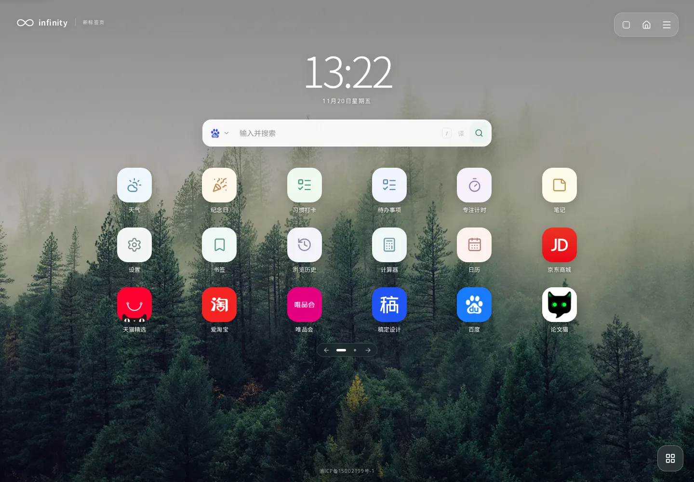

# inftab-mirror

Infinity New Tab 的可维护前端重建。页面使用 Vue 3、TypeScript 和 Vite；原静态镜像保存在 `reference/legacy-mirror/`，作为视觉、资源和行为对照。

## 界面设计

采用「雾林 · 轻透」视觉：大字号时钟、磨砂搜索框、柔和彩色工具图标、卡片式设置面板，并适配深色模式和移动端。已有的本地偏好保持不变；设计规范与更多截图见 [`docs/ui-design.md`](docs/ui-design.md)。



## 常用操作

- **更简洁的翻页**：底部仅保留可点击的分页圆点，不再显示左右箭头。末页入口不足时仍预留相同行高，圆点不再上跳；方向键、滑动、触控板和三种翻页效果继续可用。
- **独立打开方式**：设置 → 首页 → 打开方式中，可分别选择网站、搜索结果、书签和历史记录是否在新标签页打开。原有默认行为不变，选择会保存在本机并随 JSON 备份迁移。
- **统一菜单**：下拉框、右键菜单和搜索引擎列表采用统一的配色、圆角和 Lucide 线性图标；支持键盘操作、深色主题和窄屏。
- **更快创建与查找**：右上角 `+` 直接新建入口，放大镜查找本地网站、文件夹和工具。可切换当前/全部工作区，按名称相关性排序，显示工作区、文件夹位置和网址；支持全角字符、多词匹配与分批展开。方向键选择、Enter 打开、`Esc` 返回，无匹配时可直接添加入口或创建文件夹；不会自动转为网络搜索。隐藏搜索栏时也可临时查找，退出后恢复原设置。
- **更清晰的快捷入口表单**：优先填写名称、网址和工作区，按需展开图标与外观并实时预览；提交错误会定位到对应字段。短屏滚动时关闭／保存始终可见，兼顾触屏、深色、键盘与减少动态效果；粘贴图片网址不会自动联网预览。[设计依据与截图](docs/ui-skill-refinements.md)记录了两个 skill 仓库的固定版本、调整和验证范围。
- **首页直接处理待办**：在设置中启用“待办概览”，即可快速添加、勾选完成和撤销最近一次完成，无需打开面板。与完整待办面板及其他标签页共享同一份本地数据，保留数量限制、备份、输入法和键盘焦点支持。
- **整理待办**：面板中在“全部 / 待完成 / 已完成”之间切换，并可叠加关键词搜索。筛选后新增会清除搜索条件并显示新任务；编辑、取消和完成后的焦点会留在可继续操作的位置。“清除已完成”始终针对全部已完成任务，并需二次确认。
- **查找与编辑笔记**：按标题或正文搜索，选择默认顺序、最近编辑或标题排序。筛选只影响左侧列表，不会切换正在编辑的笔记；新建时清除搜索并聚焦标题，底部显示正文字符数和本机自动保存说明。
- **分层退出**：待办、笔记的查找框中，第一次 `Esc` 清除非空搜索，搜索为空时再按才关闭面板；待办编辑中按 `Esc` 只取消当前编辑。删除确认取消或完成后也会恢复操作焦点。

筛选和排序是临时视图，不会重排或删除原始数据，也不会修改备份格式；本地入口查找的关键词不保存、不联网。笔记内容和当前选中项继续保存在本机浏览器。

本轮交互优化参考了 Bonjourr 的快捷链接分组、nightTab 的本地/网页搜索边界和 Tabliss 的可操作待办；[参考记录](docs/product-reference-audit.md#开源同类项目从参考到设计2026-11-20)列出检查过的源码、固定提交及取舍。没有引入第三方代码、依赖或后台请求。

## 本地开发

需要 Node.js 22.22.2+（22.x）、24.15.0+（24.x）或 26+，推荐使用 Node.js 24 LTS。仓库提供 `.nvmrc`，可先运行 `nvm install` / `nvm use` 切换到推荐版本。版本要求覆盖开发、构建和 jsdom 测试环境。

```sh
npm ci
npm run dev
```

Vite 会在终端输出本地预览地址。生产构建和本地预览：

```sh
npm run build
npm run preview
```

运行单元和组件回归测试：

```sh
npm test
```

提交前可用一条命令完成类型与插件契约检查、回归测试、生产构建、体积预算及扩展包校验：

```sh
npm run verify
npm audit
```

首屏 JS gzip 预算为 60.5 KiB，全部 JS gzip 预算为 156 KiB，首屏预算保持不变，全量预算独立管理。构建会合并静态启动依赖以减少碎片请求；待办、笔记、月历、纪念日、计算器和专注计时组成按需下载的本地工具包。本地概览、浏览器概览和浏览器工具分别按组懒加载：打开其中一个视图可能下载同组代码，但不会挂载其他组件、读取数据或申请权限。本地入口查找、其余面板和备份解析仍按需加载。加载失败时可重试；如果浏览器缓存了失败模块，可主动选择“重新加载页面”恢复。

`package.json` 为开发依赖 `js-beautify` 的 `editorconfig`、`glob` 子依赖指定了修复版本，并在锁文件中升级了 `undici`，用于消除已知安全问题。这些依赖不进入网站或扩展的运行时代码；上游依赖升级后应复查并移除不再需要的 overrides。

Run the browser-level user-flow checks with:

```sh
npx playwright install chromium chrome msedge
npm run test:e2e
npm run test:e2e:stable
```

The default end-to-end suite covers shortcut creation and persistence, scoped/ranked local search and cross-workspace opening, light/dark mobile search scrolling, homepage quick tasks and cross-tab synchronization, todo filtering and edit focus, note search and sorting, panel open/close, widget add/reorder/remove and persistence, settings persistence, and narrow-screen overflow. `test:e2e:stable` builds the production site, then runs focused homepage, translation, responsive-layout, and shortcut-persistence checks in installed stable Chrome and Edge channels. GitHub Actions runs the full browser, production preview, and packaged-extension suite only in **Release validation**, triggered manually, on milestone tags such as `v1.1.0`, or when a milestone release note under `docs/releases/` reaches main. Ordinary PRs run `npm run verify` without installing browsers. Main-branch Pages deployments build and validate the production assets without repeating browser or unit suites. Browser reports and the verified release build are retained as workflow artifacts.

To run the same user flows against the production build and its lazy-loaded assets, run:

```sh
npm run test:e2e:production
```

This command builds the app first, then starts Vite's production preview server for Playwright.

To load the built package as a real Manifest V3 extension in an isolated Chromium profile and verify the new-tab override, shortcut persistence, and optional-permission defaults, run:

```sh
npm run test:e2e:extension
```

## CI 与版本发布策略

- 日常 PR：类型检查、单元/组件回归、一次生产构建、资源及包体积校验；无需下载浏览器。
- 合并到 main：仅构建与校验产物后自动更新 Pages，属于持续预览，不等同于正式版本验收。
- 正式里程碑版本（如 v1.1.0、v1.2.0）：合并 `docs/releases/vX.Y.0.md` 正式里程碑说明、推送对应 tag 或手动运行 Release validation，对相同提交运行全部浏览器、生产和扩展测试。正式 Release/扩展发布前必须确认该提交的完整验证通过；V1.7.0 使用专用发布 job：只有 main 上相同提交的完整验证成功后，才将已验证的独立网站及扩展 ZIP 与 SHA256SUMS 发布至 GitHub Release；已有 Release 不覆盖。其他版本仍需明确发布授权。
- 小修订与补丁 tag 默认不触发全量 E2E；涉及数据迁移、权限、导航等高风险改动时，可手动运行 Release validation 或针对性 E2E。
- Focused UI validation 仅在浮层焦点、首页导航、命令面板、主题令牌或专项测试文件变化时运行 Chromium 专项验证，也支持手动触发；不作为所有普通 PR 的全量回归门禁。

GitHub Pages 使用 `npm run build:web` 生成的 `dist-web/` 作为发布目录；浏览器扩展继续使用 `npm run build` 生成的 `dist/`。首次部署前，在仓库 **Settings → Pages → Build and deployment** 中将 Source 设为 **GitHub Actions**。之后推送到 `main` 会自动构建并发布；也可以在 Actions 页面手动运行工作流。`vite.config.ts` 使用相对资源路径，支持部署在仓库子路径下。

核心 dist 目录作为 Chrome Manifest V3 新标签页扩展加载：运行 npm run build，在 chrome://extensions 开启开发者模式后选择“加载已解压的扩展程序”，并选择 dist/。天气和 Hacker News 资讯所需的主机权限，以及书签、剪贴板写入、浏览历史访问、读取当前窗口标签页和常用网站等浏览器权限，均为可选权限；扩展不会在安装时申请这些权限，只在用户启用对应组件并点击授权，或主动使用相应功能时申请。标签页导入仅列出当前窗口中安全的 HTTP(S) 网页；浏览历史面板只搜索和打开记录，不删除或上传历史。快捷入口图标网址在扩展模式下直接作为图片加载，不申请任意网站访问权限。扩展与普通网站使用各自的浏览器存储空间，可通过 JSON 备份迁移设置。

## 项目结构

```text
src/
  components/       搜索栏、快捷入口、设置、首页小组件、书签、日历、待办、纪念日、笔记、天气面板
  composables/      本地工作区状态、浏览器存储和可选浏览器权限资源
  data/             默认快捷入口、日历日期计算、搜索引擎、资讯/天气 API、书签 API、搜索地址和外观选项
  plugins/          内置面板和首页小组件注册表、入口路由和数据适配器
  styles/           页面与响应式样式
  App.vue           页面状态和功能组合
  main.ts           应用入口
public/
  wallpapers/       本地壁纸
  inftab-icons/     旧镜像中的常用站点和内置图标
  search-engines/   搜索引擎标识
reference/
  legacy-mirror/    原始打包版镜像，仅用于对照
```

## 已实现

按平台和功能分类的当前能力清单见 [`docs/implemented-features.md`](docs/implemented-features.md)。

- 百度、Google、Bing、搜狗、360、Yahoo 和 DuckDuckGo 搜索；支持网页、图片、新闻、视频和地图分类
- 可添加最多 20 个自定义搜索引擎；HTTPS 查询模板会安全编码搜索词，并随本地数据一起备份和迁移
- 浏览器扩展可按需授权读取浏览器书签、筛选并将条目预填到首页快捷入口；网站版本会说明该能力仅在扩展中可用
- 浏览器扩展可按需授权搜索浏览历史；历史列表支持关键词筛选、显示访问时间，网站版本会说明该能力仅在扩展中可用
- Chrome 扩展添加快捷入口时可按需授权从当前窗口的打开标签页填入网页标题和网址；网站版本保留手动输入，未使用该能力时不会读取标签页
- Chrome 扩展也可按需授权从浏览器“常用网站”列表导入网址；只在点击导入时申请 `topSites` 权限，过滤不安全地址并去重，网站版本保留手动输入
- 搜索栏支持将输入内容快速交给 Google 翻译并译为简体中文；该功能由用户主动点击，翻译工具按需加载，不会在本地保存搜索文本
- 快捷入口的添加、编辑、删除、拖动排序和分页；支持右键菜单、触屏长按排序、左右滑动/触控板切页，以及微粒消散、光迹拖尾和平滑滑动三种翻页效果；系统开启减少动态效果时仍播放所选翻页效果，但会缩短时长让动画更轻柔
- 可创建快捷入口文件夹，将多个已有入口收纳在一起；文件夹与入口共用拖动排序，并包含在 JSON 备份中
- 主页工作区支持创建、切换、重命名、排序和删除；快捷入口与文件夹按工作区隔离，默认工作区固定在首位。右下角显示当前工作区名称，点击展开列表；使用每行的“更多操作”进行管理，超过 8 个时可搜索，最多 20 个。新建时先命名，切换和排序保存在本机并写入备份。
- 按 `/` 或 `Ctrl+K`（macOS 为 `⌘+K`）快速聚焦网页搜索；按 `Ctrl+F`（macOS 为 `⌘+F`）或右上角放大镜打开本地入口查找，支持当前/全部工作区、名称相关性排序、位置提示、多词匹配和空状态创建，不发送搜索词
- 首页显示本地时间和日期，并可在设置中关闭；页面恢复到前台时会重新校准时钟
- 网站入口优先使用旧镜像保存的站点图标，内置工具使用统一的线性图标；自定义入口支持上传图片并压缩为 Base64 存入本机，离线可用（远程图标网址会在保存时尝试转存，遇到跨域限制时请上传图片）
- 首页内容会随宽度扩展到 1040px；手机端最多四列、平板窄屏最多五列，并按窗口高度和当前入口数量自适应图标与行距，尽量让完整图标页、页码和底部信息同时可见
- 本地待办支持新增、编辑、完成、删除、清除已完成，以及关键词与完成状态组合筛选；保留任务总数和当前筛选数量提示
- 本地笔记支持标题/正文搜索、默认/最近编辑/标题排序、新建后立即编辑，以及 Unicode 正文字符计数；内容自动保存在本机
- 离线四则计算器支持括号、键盘输入与按键操作
- 本地习惯打卡（添加、重命名、删除与按本地日期完成/撤销；首页小组件显示当日进度，记录纳入 JSON 备份并兼容旧备份）
- 专注计时器支持 15、25、50 分钟专注时长；结束后按四轮节奏进入短休息或长休息，关闭面板和刷新页面后继续计时
- 首页可固定待办概览、纪念日倒计时、笔记预览、月历、当前天气、专注计时、浏览器书签概览、最近访问、浏览器常用网站和 Hacker News 热门资讯小组件；天气和资讯仅在用户启用组件后请求数据，Chrome 扩展还需用户点击组件中的授权按钮，分别申请 Open-Meteo 或 Hacker News 的精确主机权限，并标明数据来源。资讯会在本地缓存最近成功的五条内容及更新时间，离线时可查看缓存并重试。书签、历史和常用网站组件只在扩展授权后显示数据；常用网站按需申请 `topSites` 权限，可随时在浏览器扩展设置中撤销。计时状态在小组件和面板间保持同步。所有小组件支持拖动排序、键盘上下调整、宽度调整和单独移除，关联面板的小组件可从标题直接打开；配置和计时器状态纳入备份，并按需加载
- 可把天气、待办、日历等内置面板固定到常驻 Dock；Dock 只显示图标，默认跟随首页图标大小，也可自定义尺寸与间距；悬停时有图标光晕，鼠标附近放大效果默认关闭，可在“动画与反馈”中开启，右键图标可移除，Dock 顺序和设置随 JSON 备份迁移
- 可查看本地日期的月历，支持跨月导航、选择日期和一键返回今天；周一作为每周起始日
- 纪念日与倒计时（添加、编辑、删除；支持一次性日期、每年重复和过期日期计时，并纳入数据备份）
- 壁纸选择、浅色/深色/跟随系统主题、背景暗度、搜索栏显隐与宽高、搜索类型标签（默认隐藏）、图标大小/圆角、每页行列数、图标间距、搜索区与图标间距、翻页动画时长和悬停光晕强度均可在设置中调整
- 内置壁纸可按小时或天自动轮换；轮换进度保存在本地并纳入 JSON 备份，自定义背景启用期间暂停
- 可上传本地壁纸；图片会缩放并压缩为 WebP 后离线保存在本机，也可通过 JSON 备份迁移
- 天气城市搜索、当前天气和未来三日预报；城市由用户手动选择，不请求设备定位
- 天气、书签、设置、笔记、待办和纪念日面板按需加载，减少打开新标签页时的首屏 JavaScript 工作
- JSON 数据备份与迁移：导入前预览，可选择按 ID 合并或替换；首页小组件和排序随页面设置一并迁移
- 个人设置、快捷入口、待办、笔记和天气城市保存在当前浏览器的 `localStorage`

## 当前边界

此版本重建的是前端交互。原站账号、云同步、原站搜索建议和通知尚未接入。Chrome 扩展的标签页、常用网站、书签、历史记录、剪贴板和联网组件权限均按功能按需申请；天气数据通过 Open-Meteo 的地理编码与天气预报 API 获取。天气面板和首页天气组件支持重试，组件刷新失败时保留上次成功结果。其余个人数据只保存在本机浏览器，JSON 导入导出可用于手动迁移。

背景图库使用归档中的本地壁纸，并保留不依赖外部图片的渐变主题；当前快照只包含一张实际壁纸图片。新增内置图片前应确认来源许可，并将素材放入 `public/wallpapers/`。个人上传的壁纸只存于当前浏览器，不会发送到服务器。

新功能优先放在 `src/components/`、`src/data/` 或新的功能模块中，不直接修改 `reference/legacy-mirror/` 内的压缩构建文件。

内置工具面板通过 `src/plugins/registry.ts` 注册组件、标题、快捷入口路由、属性和事件适配器；首页小组件通过 `src/plugins/widgetRegistry.ts` 注册视图、上下文数据和可选的关联面板。添加功能时应在对应注册表声明，并增加数据校验、备份兼容及用户交互测试。注册表目前只加载仓库内受信任的模块，不执行远程插件代码；面板与小组件都按需加载，避免增加首屏工作。

面板和小组件 ID 集中在 `src/plugins/ids.ts`，注册表通过 TypeScript 校验 ID 清单与实现是否齐全。新增内置面板或首页小组件的步骤、状态和测试要求见 [`docs/plugin-development.md`](docs/plugin-development.md)。

参考产品及可核实功能记录见 [`docs/product-reference-audit.md`](docs/product-reference-audit.md)。

### 网站离线工作台

网站默认仅加载轻量离线入口。启用后预缓存校验过的站内应用资源，支持本地快捷入口、笔记、待办等功能；天气、外部搜索和第三方站点仍需网络。更新验证完成后关闭所有工作台标签页再打开。离线缓存不包含用户数据，停用只清理本项目缓存。浏览器安装方式取决于平台；MV3 扩展没有网站 Service Worker。
